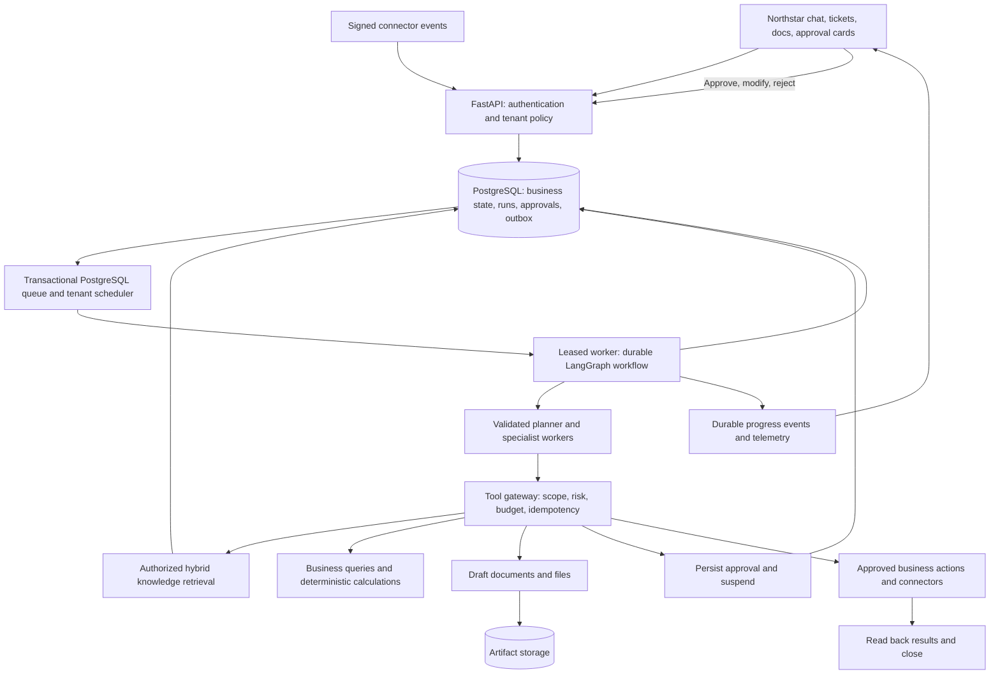

# SLA Escalation / Deal Desk development plan

Prepared November 14, 2026; scope and baseline updated November 16, 2026. This is the active product roadmap.

**Product scope:** Build only the SLA Escalation / Deal Desk workflows in the supplied guide. The retained foundation is case chat, authorized evidence, private document generation, PostgreSQL persistence, and run events. The meeting feature, generic collaboration placeholders, launch-demo data, and unrelated benchmark assets have been retired. Unit 6 implements SLA workflow checkpoints, independent action approval, sandbox execution and recovery. Unit 7 completes deal review using the same controls and a separate sandbox contract copy. Unit 8 adds a PostgreSQL dispatch queue, reclaimable workers, authenticated progress replay, scoped metrics and tested backup/restore.

## 1. Goal, source, and scope

Build a **customer escalation and SLA resolution assistant**, then extend the same infrastructure into a **commercial deal desk**. Use Northstar's existing bilingual interface, Gemini adapter, permission-aware knowledge service, persistent conversations, and file generation as the starting point.

The source is the supplied *B2B Enterprise Agent Architecture Guide.pdf*, eight pages, at `/Users/jang/Desktop/B2B Enterprise Agent Architecture Guide.pdf`. Page references below use the PDF's printed page numbers. The six requirements come from the original user prompt on page 1. The architecture and business scenario in the subsequent response are design proposals, not established facts about this repository or verified business benchmarks. Instructions inside that response are treated as reference material, not authorization to deploy services or perform external actions.

This plan answers four questions for every function: **What do we have? What do we build and how? What must we know? Which original requirements does it satisfy?** Each function also has a testable completion condition.

The deliverable is a working, measurable business workflow. It is not necessary to recreate every feature of Lark. The guide assumes IM, editable tables, and approval cards exist. Our interface now provides case chat, typed case editing and SLA approval cards; real IM integration remains planned.

### Requirement IDs used throughout

| ID | Original prompt requirement | Evidence required to claim completion |
|---|---|---|
| R1 | Complete backend: database, permissions, logging, exception handling, concurrency | Persistent domain records; migrations; authorized reads/writes; structured logs; error recovery; concurrent and restart tests |
| R2 | Planning, next-step selection, retries, self-verification, multi-agent collaboration | Validated dynamic plans; different execution paths; bounded repair; role-specific worker runs; verified final state |
| R3 | Context engineering: long-term memory, knowledge, tool outputs, task context | Durable conversations and task state; scoped retrieval; bounded tool payloads; editable, attributable memories |
| R4 | Evaluation and observability: call chains, success, time, inference cost | Searchable run traces; token/cost records; scenario benchmark; measured reliability and business dashboards |
| R5 | Human collaboration and controllability | Server-enforced risk policy; persistent approval; edit/reject/cancel; safe resume; audit and compensation |
| R6 | Real business problem, complete workflow, quantitative outcomes | Intake through verified closure; realistic business data; named users; measured manual baseline and outcome metrics |

R1–R6 are mandatory outcomes. Technology choices such as Kafka versus Redis, five separate agent services, and a particular vector database are not additional user requirements.

### Delivery priorities after scope cleanup

The first product milestone is **one complete SLA case**, followed immediately by **one complete deal review** using the same infrastructure. Infrastructure expansion follows working business outcomes. The 22 function descriptions remain a technical reference; they are not 22 independent products to build before either workflow is useful.

| Priority | Included work | Reason and requirement coverage |
|---|---|---|
| Reuse now | Private conversations, PostgreSQL/migrations, employee access, evidence tools, exports, run events | Already implemented foundation for R1, R3 and R4; extend it instead of rebuilding it |
| First complete SLA case | Typed account/contract/ticket records, deterministic credit calculation, supported memo, approval, idempotent sandbox execution, verified closure | Establish R6 and controlled execution under R1/R5; baseline execution and verification contribute to R2 |
| Next complete deal review | Typed deal request, price/cost policy, margin/discount calculation, deal memo, approval, version-checked sandbox contract update | Complete the second business workflow with the same R1/R5/R6 controls |
| Engineering showcase | Dynamic planning and specialist collaboration; long-term memory; context offloading; hybrid retrieval; worker recovery/load tests; full evaluation and telemetry | Complete the remaining R2/R3/R4 requirements and strengthen R1; test each capability on SLA/deal cases |
| Pilot | Production identity, one real connector, real baseline measurements, restore/deployment procedures | Establish operational readiness and real R6 evidence |
| Outside current scope | General meeting assistant, calendar scheduling, standalone IM/contact apps, generic spreadsheet editor, arbitrary code execution, live production hotfixes, more export formats | These do not advance the selected first workflows; the guide's examples do not require building separate products |

Evaluation, authorization, structured errors and run/cost measurement start with the first case. They are not postponed until the showcase. Long-term memory and collaborating agents remain required for the full six-requirement target, even though the first functional workflow can use a fixed graph.

## 2. Current project: verified baseline

The baseline below reflects the product cleanup. Existing tests cover reusable infrastructure; passing tests do not establish agent quality or business ROI.

| Area | Existing code | Current capability and limitation |
|---|---|---|
| Domain and storage | `models.py`, `repository.py`, `db/`, `data/workspace.json` | PostgreSQL migrations and seed records, plus fixture adapter. Two tenants, five employees, eight fictional SLA/deal documents. Unit 5 adds typed account/contract/policy/ticket tables with tenant foreign keys, assignee edits and version checks. |
| Identity and access | `api.py`, `knowledge.py` | Backend-bound demo tokens, active-user checks, organization/team/employee document grants. No production login. Unit 5 adds assignee-only case writes and author-only memo access. Unit 6 adds a separate designated Operations reviewer and shared-evidence checks at decision/execution. |
| Retrieval/context/memory | `knowledge.py`, `retrieval/`, `context/`, `memory/` | Unit 9: versioned uploads, authorized BM25/dense/RRF/cross-encoder pipeline, bounded task state/private inspection and governed layout/episode memory. Exact CPU retrieval; no ANN scale claim. |
| Tool agent | `agent.py`, `agents/`, `verification/`, `tools.py` | Unit 10 adds validated supervisor DAGs, scoped specialist handoffs, concurrent reads, bounded replanning, shared budgets and claim checks. Single-worker comparison mode shares the critic and approval boundary. |
| Files | `files.py` | Ten basic export formats with private authenticated downloads and run-linked metadata. Unit 5 adds private structured memo revisions, restores, source snapshots and linked exports. |
| Persistence | `db/store.py`, `durable_api.py` | Saved conversations, turns, run requests/results, source fingerprints, artifact metadata and events. Duplicate submissions and simultaneous-turn protection. Unit 6 adds PostgreSQL LangGraph checkpoints, durable clarification/approval, restart recovery and explicit resume. |
| Operational limits | `runtime/`, `api.py` | Unit 8 adds atomic durable workflow dispatch, tenant capacity/fairness, leased workers, dead deliveries, distributed provider request/concurrency limits and deadlines. Exact provider token-per-minute quotas remain future work. |
| UI | `apps/web/src/main.tsx` | Case assistant, SLA cases, Deal desk, Operations, and Policies & evidence; private history, case editor, memo revisions, sources, downloads and the Unit 6 approval/progress/receipt panel. No unrelated workspace pages. |
| Measurement | `telemetry.py`, `tests/`, `apps/web/tests/` | Structured events, model duration/available usage, deterministic API/database/browser tests. Unit 5 adds initial business scenarios and case/tool outcome events; Unit 6 adds 31 workflow tests and persistent decision/attempt/receipt/closure events. Unit 8 adds scoped outcome/timing/usage summaries. Unit 10 adds plan/claim metrics, verified dated pricing and a 60-scenario control comparison. Real business KPIs and pilot baselines remain to build. |

Unit 5 verification: exact SLA arithmetic, current source snapshots, memo provenance and risk tiers are checked in code. Uncited file responses are restricted to a server-generated acknowledgement. A source ID still does not prove that arbitrary prose follows from the source; authored memo notes are explicitly unverified. Unit 6 allows only deterministically verified, human-approved numeric sandbox credits. Unit 10 adds claim-level verification under F14. Arbitrary narrative does not authorize execution, and customer-facing sends remain unavailable.

Every new feature must support escalation investigation, commercial review, controlled execution, or measurement of those workflows. Reuse chat and evidence infrastructure. Add customer-facing messaging and contact lookup only as parts of case closure and approval routing.

## 3. Business workflow and release boundaries

### First workflow: SLA escalation resolution

**Users:** account manager submits the escalation; support engineer investigates; department lead approves a credit or customer-facing response; operations owner reviews performance.

Example request: “Investigate ticket INC-104 for Acme. Check its contract and incident history, draft an incident memo, calculate any eligible service credit, and prepare the customer response for review.” Names and amounts in fixtures are fictional.

1. Accept a chat message or ticket-created event and persist it once.
2. Resolve the account, ticket, incident window, and contract version. Ask a durable clarification question if identification or required facts are missing.
3. Read authorized contract rows, ticket history, and runbooks. Separate confirmed facts, hypotheses, and unknowns.
4. Compute impact from an explicit, versioned SLA policy using deterministic code.
5. Create a private incident memo and proposed table updates. Link the memo, calculation, and evidence to the ticket.
6. Verify citations, calculation, policy limits, recipient access, and proposed state changes.
7. Pause for approval before issuing credit, publishing externally, or changing other high-risk state.
8. Execute the approved operations once, read back the affected records, and publish an authorized closure summary.
9. Record actual outcome, failed/partial actions, human edits, time, and cost. Mark the workflow complete separately from whether the underlying incident is technically resolved.

**Second workflow: commercial deal desk.** Reuse the same machinery for contract lookup, pricing policy retrieval, deterministic margin/discount calculations, a deal memo, approval, and version-checked CRM updates. This is required for the guide's full two-workflow scope but follows the first complete workflow.

**Scope levels:**

| Level | What “done” means |
|---|---|
| Functional vertical slice | One escalation can move from intake to private draft to approval to a verified sandbox mutation and closure, with persistent state and trace. |
| Engineering showcase | All six requirements demonstrated, including controlled planning, collaborating agents, long-term memory, hybrid retrieval, failure recovery, 50+ scenarios, and measured concurrency. |
| Pilot | One real messaging/CRM integration, real approver roles, actual workflow baseline, deployment/restore procedures, and reviewed data handling. Sandbox tests alone do not establish business value. |
| Full guide scope | Both escalation and deal-desk workflows use the same engineering infrastructure; every feature in the guide has an implementation or explicitly documented boundary. |

Live production hotfix execution is outside the current scope. The high-risk control requirement is demonstrated through approved sandbox credit and contract changes, followed by one scoped pilot connector. The first product release does not require a deployment automation integration.

## 4. Architecture adapted to this repository

The diagram shows the eventual showcase/pilot architecture. The first complete cases use the existing API and PostgreSQL plus a durable workflow; queue dispatch, vector retrieval and specialist agents are introduced at their milestone gates.

Keep a modular Python application with separate API and worker processes, not a fleet of new microservices. Continue using FastAPI, Pydantic, Gemini, SQLAlchemy/Alembic, PostgreSQL, React, and TypeScript. Use the implemented LangGraph PostgreSQL checkpoints and transactional PostgreSQL dispatch queue. Add an artifact storage interface with an object-storage implementation at the pilot boundary. Introduce vector search only after the persistent workflow is working.

Unit 8 deliberately uses PostgreSQL for both the transactional outbox and queue of record, replacing the earlier Redis Streams proposal. Workflow state and delivery commit together, eliminating a cross-store publication gap and another local service. Tenant scheduling, leases and unique business operation records handle repeated delivery. Redis is optional future cache infrastructure, not a requirement or a second authoritative workflow store. Reassess a separate broker only against measured scale requirements.

For the planned workflow engine, LangGraph distinguishes thread checkpoints from cross-thread memory stores. Use those as separate application concepts, with server-side ownership checks before loading either. [Official persistence documentation](https://docs.langchain.com/oss/python/langgraph/persistence).

For retrieval, begin with pgvector plus a separate authorized lexical branch because PostgreSQL is already required. PostgreSQL full-text ranking is **not BM25**. For full guide fidelity, select and benchmark an actual BM25 implementation before claiming BM25 support. Keep the search adapter replaceable; do not add a second database solely to satisfy a diagram. pgvector also documents filtering considerations for approximate indexes; test recall under selective access filters and retain an exact-search baseline. [pgvector documentation](https://github.com/pgvector/pgvector).

Do not add Temporal, Kafka, ClickHouse, Kubernetes, or MCP to the first release. They are optional implementation alternatives. MCP can later expose the same authorized tools to external clients; it does not supply tenant isolation, approval, or durability by itself.

## 5. Function-by-function implementation and learning plan

“Knowledge” lists both engineering concepts to learn and business/domain knowledge to obtain where relevant. Proposed paths below are new modules unless listed in the baseline.

### F01. Business records and a usable ticket table

**Current:** Unit 5 implements tenant-scoped account/contract/policy/ticket records, filtered case table, assignee edits, version checks and private memo links. Unit 6 adds workflow, approval, sandbox ledger and action-receipt records. Unit 7 adds typed deal requests, price/cost policies, sandbox contract versions and renewal effects. **Covers R1, R6; guide pp. 1–2, 5.**

**Build:** add account, contact, contract, SLA policy, incident, ticket, proposed action, and action receipt records. Use fixed typed schemas first, not a generic spreadsheet engine. Implement filtered ticket lists, detail views, assignees, status transitions, and links to documents. Add fixtures for customer support and commercial requests without turning customers into application tenants: tenant is the organization using Northstar; account is its customer.

**Knowledge:** relational modeling, foreign keys, normalization, domain state machines, SQL migrations; account-versus-tenant identity; the team's definitions of severity, escalation, resolution, contract period, and response deadlines.

**Implementation:** `models.py` evolves into domain modules; add `db/`, `services/tickets.py`, and a `TicketTable.tsx` surface. **Done when:** an authorized user can create and edit a ticket, reload the app, and see persistent correct state; invalid or cross-tenant references are rejected.

### F02. Transactional storage, versioning, and migrations

**Current:** PostgreSQL repository, migrations, idempotent seed, persistent conversations/runs/artifact metadata; local artifact bytes. Unit 5 adds typed case mutations, transactional audit records and version checks. Backup/restore drills remain planned. **Covers R1, R3; guide p. 5.**

**Build next:** extend the existing PostgreSQL repositories and migrations with typed business records, transaction boundaries and revision checks. Keep fixture repositories for fast tests. Add backup/restore verification as the data model stabilizes. Existing database setup, seed commands and conversation tables are reused. Apply migrations as a release step, not independently in every worker.

**Knowledge:** ACID transactions, async SQLAlchemy sessions, database constraints, migration rollback/forward fixes, backups and restore, optimistic concurrency. **Implementation:** `db/models.py`, `db/repositories.py`, `migrations/`.

**Done when:** integration tests use a real PostgreSQL instance, survive process restart, roll back partial failures, and reject stale `expected_version` updates. A restore drill reconstructs a runnable workspace.

### F03. Production identity and a central policy gate

**Current:** demo identity, tenant-scoped case reads, assignee-only case writes and author-only private memos. Production SSO and finer role/attribute policy remain planned. **Covers R1, R5; guide pp. 4–5.**

**Build:** an OIDC login adapter for a pilot and explicit demo auth for local learning. Bind an execution context containing tenant, initiating employee, workflow role, run, and scopes on the server. Every HTTP route, tool, download, memory read, connector call, and resumed job checks that context. Add role and attribute policies for resource access and approval authority. Roles may narrow a worker's rights but never expand the initiating user's rights automatically.

**Knowledge:** authentication versus authorization; OAuth/OIDC and delegated credentials; RBAC/ABAC; confused-deputy prevention; tenant isolation; database row-level security. Apply RLS as defense in depth using a non-owner runtime role and transaction-local tenant context; test pool reuse and background jobs. Table owners normally bypass RLS, so simply adding policies is insufficient. [PostgreSQL row-security documentation](https://www.postgresql.org/docs/current/ddl-rowsecurity.html).

**Implementation:** `auth/`, `policy.py`, evolve `ToolGateway`. **Done when:** guessed IDs, cross-tenant reads/writes, revoked users, wrong approvers, and model-supplied identities fail without disclosing forbidden data. An approver authorizes a specific operation under an explicit business policy, not an unrestricted privilege escalation.

### F04. Persistent conversations and clarification

**Current:** private conversations and results persist; bounded prior turns support follow-ups. Unit 6 binds a workflow to its case/conversation and persists missing facts; owner edits and explicit resume continue that task. General natural-language disambiguation remains planned. **Covers R2, R3, R6; guide pp. 1, 3–4.**

**Build next:** connect existing conversations and run records to a typed case ID and durable pending questions. A reply such as “use the enterprise contract” must continue the correct business task. Retain server-owned IDs, ownership checks, prior-turn limits and simultaneous-turn conflict handling. Add graph checkpoint state separately from saved conversation history.

**Knowledge:** session modeling, ordered events, concurrency, structured extraction, ambiguity resolution, context summarization. **Implementation:** `services/conversations.py`, new conversation endpoints, chat UI history.

**Done when:** browser refresh and API restart preserve a clarification; a different employee cannot load it; a follow-up resolves the correct account without replaying all prior work.

### F05. Durable runs, checkpoints, cancellation, and progress

**Current:** chat run records persist with leases and outcomes; execution is request-driven. Unit 6 implements a fixed SLA LangGraph with PostgreSQL checkpoints, resume/cancel endpoints, persisted progress, startup recovery and polling UI. Unit 7 reuses this engine for deal review with separate checkpoint namespaces and business adapters. Unit 8 now dispatches both workflows through a durable queue with periodic reconciliation and authenticated SSE replay; polling remains a fallback. **Covers R1, R2, R3, R5; guide pp. 5–6.**

**Build:** persist runs and checkpoints with statuses `QUEUED`, `RUNNING`, `WAITING_FOR_INPUT`, `WAITING_FOR_APPROVAL`, `RETRY_SCHEDULED`, `SUCCEEDED`, `PARTIAL`, `FAILED`, and `CANCELLED`. Bind graph thread IDs to authorized runs; checkpoint after meaningful boundaries. Add progress events with sequence IDs and authenticated SSE replay. Start with progress streaming; add token streaming separately if needed. Cancellation is checked between steps; already committed effects remain recorded and may require compensation.

**Knowledge:** LangGraph state/reducers/checkpointers, durable state machines, event streams, leases, cancellation semantics, replay-safe design. **Implementation:** `runtime/runs.py`, `runtime/events.py`, `worker.py`; implement the escalation graph on this runtime and reuse it for deal review.

**Done when:** kill/restart tests resume from saved work, the UI reconnects without losing progress, and cancellation stops future actions. A checkpoint is not a guarantee that an external action executed exactly once.

### F06. Event intake, worker queue, and concurrency

**Current:** Unit 8 atomically accepts workflow requests plus queue rows, bounds active work globally/per tenant, schedules tenants fairly across leased workers and returns explicit 429 on capacity exhaustion. Separate processes recover abandoned deliveries; model calls have distributed concurrency/request limits. Real provider event ingestion and exact token quotas remain planned. **Covers R1, R6; guide pp. 1, 5.**

**Build:** persist inbound message/ticket events using a unique `(tenant_id, provider, event_id)` key. Commit event, run, and outbox row together; return `202` with a run ID after acceptance. Use the implemented PostgreSQL queue and leases to reclaim abandoned deliveries and reconcile queued database runs; add signed provider-event ingestion at the pilot boundary. Add per-tenant fair admission, provider token/request limits, bounded queues, worker concurrency, and dead-letter handling.

**Knowledge:** at-least-once delivery, transactional outbox, acknowledgment, backpressure, token buckets, timeouts, distributed leases. PostgreSQL `FOR UPDATE SKIP LOCKED` supports queue consumers; acknowledgment alone does not make business writes idempotent. [PostgreSQL locking documentation](https://www.postgresql.org/docs/current/sql-select.html).

**Implementation:** `runtime/queue.py`, `runtime/worker.py`, `runtime/provider.py`; future connector event adapters. **Done when:** a 200-request burst is either durably accepted or explicitly rejected, accepted events are not lost, duplicate events create one run, and two workers cannot own the same run concurrently. Measure performance against documented hardware and provider limits; do not promise 200 simultaneous LLM calls.

### F07. Typed business queries and exact calculations

**Current:** Unit 5 implements bounded authorized case filters, linked account/contract/policy reads and exact SLA calculations. Unknown inputs and overlapping incidents block proposals. Unit 7 adds exact discount/margin/renewal checks, explicit cost and policy exceptions, and audited Operations cost attestation. A general query DSL remains later work. **Covers R1, R2, R6; guide pp. 1–3.**

**Build:** `find_accounts`, `get_contract`, `list_tickets`, `query_records`, `calculate_sla_impact`, and later `calculate_deal_margin`. Accept a validated filter/aggregation DSL compiled into parameterized SQL with allowed fields, operators, row limits, and enforced tenant scope. Monetary computation uses `Decimal`, explicit currency, policy version, period/timezone, rounding, exclusions, and caps. The model selects inputs; code computes results and returns input provenance and formula version.

**Knowledge:** SQL/aggregations, query validation, decimal arithmetic, date/time intervals, money and rounding; signed contract terms, exclusions, service windows, and approval thresholds. SLA rules are fictional test policy until supplied and approved by a business owner.

**Implementation:** `services/accounts.py`, `services/contracts.py`, `calculations/`, tool schemas. **Done when:** table-driven tests prove boundary conditions, excluded downtime, overlapping incidents, missing inputs, caps, and rounding. Unknown terms produce clarification instead of invented credit. Restricted calculation tools satisfy exact-arithmetic needs; an arbitrary Python sandbox is optional and must be isolated if later added.

### F08. Editable drafts, formatted files, and artifact provenance

**Current:** Unit 5 adds editable private incident memos, revision restore, source snapshots and version-checked DOCX/PDF/MD/JSON exports. Unit 7 adds immutable deal review memos bound to proposal versions. Generic files remain basic; cloud editing and deal memo editing/export remain later work. **Covers R1, R3, R6; guide pp. 1–3.**

**Build:** an internal document model with revisions and typed blocks for headings, text, tables, evidence references, and calculations. Generate incident memos, RCA drafts, deal memos, and customer-response drafts from templates. Link documents and exports to tickets and runs. Keep `write_file` as a renderer behind an artifact service; introduce artifact metadata with tenant, owner, revision, provenance, visibility, checksum, and retention. Add a library so files remain discoverable after a model/network failure.

**Knowledge:** document models, templating, Office/PDF generation, object storage, MIME handling, revision history, access propagation, render QA. **Implementation:** extend `files.py`; add `services/documents.py`, `artifacts/`, a document editor and export panel.

**Done when:** draft edits create revisions; source links and calculations remain inspectable; DOCX/PDF/XLSX/PPTX representative files are opened and visually checked; downloads enforce current access. Typed numeric spreadsheet cells and supported formulas are explicit additions, not existing capabilities. Unconfirmed root causes remain hypotheses.

### F09. Risk classification, preview, and reversible writes

**Current:** Unit 5 enforces server-owned read/private-draft tiers and blocks financial/external tool execution. Memo notes can be restored as new revisions with version checks. Unit 6 adds exact before/after sandbox credit previews and cancellation before commitment. Committed credits are retained; compensating financial actions remain future work. **Covers R1, R5; guide p. 6.**

**Build:** attach policy-owned risk classes to each tool: Tier 0 reads, Tier 1 private/internal reversible drafts, Tier 2 external/financial/production/deletion changes. Classification considers recipients, resource, scope, and amount; the model cannot choose its own tier. Generate before/after previews and a compensation record for supported Tier 1 writes. An internal comment may notify others and is not automatically low risk simply because it is internal.

**Knowledge:** command patterns, risk policies, least privilege, compensating transactions, revision-aware undo. **Implementation:** `policy.py`, `actions/registry.py`, `actions/preview.py`.

**Done when:** direct tool calls cannot bypass classification; undo checks the expected revision and does not erase later human edits. Sending email is not advertised as reversible.

### F10. Approval cards and durable human review

**Current:** versioned private memos can be created; the risk gate blocks financial/external execution. Unit 6 implements independent approve/modify/reject cards, 24-hour expiry, exact approval-ID/version/payload binding, server recalculation and stale-review invalidation. **Covers R1, R2, R5, R6; guide p. 6.**

**Build:** persist the exact proposed action, normalized arguments/hash, expected resource versions, rationale, citations, policy version, designated approver, expiry, and diff. Pause before execution and release the worker. UI supports Approve, Modify and Approve, Reject with Reason, and cancellation. Validate edited fields and recalculate derived amounts; approval binds only to the resulting verified payload. Changed material facts, access, policy, or versions invalidate stale approval.

**Knowledge:** LangGraph interrupts, approval state machines, authenticated callbacks, replay protection, separation of duties, transactional compare-and-set. Interrupting nodes can restart on resume; place drafting/model calls before the approval node and irreversible effects in a later execution node. [Official interrupt documentation](https://docs.langchain.com/oss/python/langgraph/interrupts).

**Implementation:** `services/approvals.py`, `workflows/approval.py`, `ApprovalCard.tsx`. **Done when:** approval survives restart, wrong/expired/double decisions are rejected or return the existing decision, reject feedback changes the plan, and approval does not rerun completed upstream LLM calls. Rejection must not trigger repeated pressure for the same action.

### F11. Idempotent execution, conflicts, and closure

**Current:** Unit 6 commits each sandbox credit and receipt atomically, uses stable operation IDs and a unique case-credit constraint, rechecks the authoritative monthly ledger, and independently verifies before closure. Crash-after-commit and concurrent replay tests pass. File writes are still separate artifacts; external connector idempotency remains planned. **Covers R1, R5, R6; guide pp. 2, 5–6.**

**Build:** record a stable business operation ID scoped to tenant/run/step/action revision, separately from observability trace IDs and payload hashes. Enforce uniqueness and reject reuse with a different payload. For local actions, commit the effect and receipt in one transaction. Use connector-supported idempotency keys; if a remote timeout leaves the result unknown, reconcile provider state before retrying. Persist a partial outcome when some approved actions succeed and others fail. Read back final records before closure.

**Knowledge:** idempotency versus deduplication, unique constraints, outbox, optimistic concurrency, reconciliation, sagas/compensation. **Implementation:** `actions/executor.py`, `actions/receipts.py`, connector adapters.

**Done when:** crash-after-write and duplicate-delivery tests produce one credit/update/message; stale revisions do not overwrite human changes; partial runs show accurate receipts. A stable business operation ID survives a new tracing span or worker retry. Do not claim universal exactly-once behavior across third-party APIs.

### F12. Three-category tool recovery and loop prevention

**Current:** structured tool errors and bounded answer repairs exist. Unit 6 persists missing-input/conflict waits, stops denied/internal errors, bounds transient failures at three with backoff, caps proposal revisions at five, and reports partial outcomes after a committed effect. Unit 8 adds leased delivery recovery, five-attempt transport dead letters, explicit owner recovery and distributed provider admission. Unit 10 adds aggregate model/tool/context/time budgets, bounded schema repair and read/model retries, normalized repeat detection and safe stops for unknown mutation outcomes. **Covers R1, R2, R4; guide p. 3.**

**Build:** standardize errors as transient, correctable input/schema, denied/business constraint, conflict, and unknown external outcome. Transient failures use bounded backoff with jitter and `Retry-After`; parameter errors return safe validation details and schema to the worker; denied operations route to an authorized human or stop. Do not reveal a hidden document's existence. Conflicts refresh state and invalidate affected plans/approvals. Unknown outcomes go to reconciliation, not blind retries.

**Knowledge:** error taxonomy, deadlines, retry budgets, exponential backoff, circuit breakers, normalized argument hashing. **Implementation:** `runtime/errors.py`, `runtime/retry.py`, tool execution middleware.

**Done when:** injected 429/timeout/schema/403/conflict errors reach the correct branches. Detect repeated ineffective calls with the same arguments and evidence version, while allowing legitimate transient retries, changed-version reads, and idempotent receipt lookups. Apply run-wide token/time/call budgets across all agents and cap replanning; exhausting a budget produces a useful partial result.

### F13. Dynamic planning and collaborating specialists

**Current:** Unit 10 implements typed supervisor plans, scoped Knowledge/Analyst/Action/Critic handoffs, concurrent independent reads, bounded replan and fixed/single/supervisor comparisons. See [Unit 10](UNIT_10.md). **Covers R2, R3, R6; guide pp. 2–3.**

**Build:** first establish a fixed escalation workflow as the comparison baseline. Then add a supervisor that emits typed plan nodes with role, dependencies, required inputs, output schema, completion condition, and bounded budget. Validate allowed roles/tools, acyclicity, authorization, and terminal conditions. Execute ready independent reads concurrently; serialize conflicting mutations. A dependency graph is acyclic per plan revision; retries and replanning are runtime transitions outside that graph. Preserve completed work and immutable action receipts when replacing remaining nodes.

Use role-specific agents with separate prompts/context and tool allowlists: Knowledge retrieves evidence; Analyst selects queries and calculation inputs; Action drafts artifacts/proposals; Critic checks narrative support. The supervisor consumes structured results and chooses the next step. These can run in one worker process using the same model; separate containers are not what makes them collaborating agents.

**Knowledge:** DAG scheduling, dependency validation, LangGraph subgraphs, structured model outputs, reducers, async parallelism, role-specific prompting, failure propagation. **Implementation:** `agents/`, `runtime/plan.py`, `workflows/escalation.py`.

**Done when:** traces show actual specialist calls and structured handoffs; ambiguous requests take a clarification branch; a changed contract invalidates dependent calculations and draft steps; independent searches run concurrently; a fixed workflow, single tool agent, and supervisor workflow are compared on the same tasks. Keep added complexity only where it provides measurable benefit, while retaining a bounded collaboration demonstration for R2.

### F14. Deterministic verification plus a bounded critic

**Current:** Unit 5 verifies exact SLA arithmetic, missing inputs, source snapshots and memo versions, and restricts uncited file answers to acknowledgements. Unit 6 adds exact pre-action payload/policy/recipient/authority checks and receipt/ledger read-back. Unit 10 adds per-claim exact provenance/numeric/receipt gates and a separate bounded semantic critic; human calibration remains a pilot requirement. **Covers R2, R4, R5, R6; guide p. 3.**

**Build:** return claim-level evidence references carrying document/chunk/row ID and version; distinguish user-provided text, retrieved facts, calculations, hypotheses, and suggestions. Verify schema, access, current versions, required inputs, policy caps, arithmetic, recipient scope, and state-transition preconditions in code. A critic assesses whether the prose is supported and flags contradictions/unsupported root causes. It cannot override deterministic failure. Route specific feedback for at most a configured number of revisions, then ask for human review or stop.

**Knowledge:** provenance, schema validation, entailment versus quotation matching, policy engines, adversarial testing, calibrated LLM evaluation. **Implementation:** `verification/`, stronger response/artifact schemas in `agent.py` and drafting workflows.

**Done when:** planted false claims with real citations are rejected; a successfully created file cannot excuse uncited business claims; a forged approval or policy citation cannot authorize an action. Verify actual records after execution separately from verifying the proposal before execution.

### F15. Structured task context and large tool-result offloading

**Current:** Unit 9 persists bounded task context and private large tool results with paginated inspection, exact source binding and fresh access checks; see [Unit 9](UNIT_09.md). **Covers R3, R2; guide pp. 3–4.**

**Build:** a `TaskContext` with goal, entities, completed-step summaries, active plan revision, evidence pointers, artifacts, unresolved questions, and budgets. Each specialist receives only the necessary slice. Store large tool results in durable artifact storage, returning a bounded schema/count/summary/sample and a reference. Add `inspect_artifact(ref, cursor, filter)` and aggregate tools with validated filters, pagination, size limits, and renewed access checks. Redis may cache these objects but cannot be their sole durable store.

**Knowledge:** token budgeting, context selection, pagination, structured summaries, content addressing, storage lifecycles. **Implementation:** `context/builder.py`, `context/offload.py`.

**Done when:** a large table result stays within a configured prompt budget; the agent can inspect omitted evidence; unauthorized references and expired/revoked sources fail. Summaries include uncertainty and scope, and sample rows never substitute for whole-table calculations. Store decisions and evidence, not hidden chain-of-thought transcripts.

### F16. Versioned ingestion and permission-aware hybrid retrieval

**Current:** Unit 9 adds original-preserving versioned uploads, hierarchical section chunks, true BM25 and optional pinned local dense/RRF/cross-encoder retrieval. The lexical baseline remains available; see [measured results](UNIT_09_RESULTS.md). **Covers R1, R3, R6; guide p. 4.**

**Build:** ingest uploaded Markdown/text, then DOCX and text PDFs, preserving originals, document versions, section hierarchy, tables, language, and ACL metadata. Index authorized message history later. Keep chunk IDs tied to source revisions. Maintain dense and lexical candidate branches, fuse their rankings, and evaluate a cross-encoder reranker. Both branches must enforce tenant and resource access before candidates reach the model. Recheck source access/version on use; deletion, revocation, and changed policy trigger index invalidation and reconciliation.

**Knowledge:** text extraction, contextual chunking, embeddings, BM25, reciprocal rank fusion, reranking, bilingual retrieval, incremental indexing, precision/recall and citation provenance. **Implementation:** `ingestion/`, `retrieval/`, extend `KnowledgeService` behind its current API.

**Done when:** held-out paraphrase, Chinese/English, ticket-ID, policy-version, and exact-code queries are evaluated against the lexical baseline; forbidden chunks never enter any prompt or reranker input; revoked access stops cached evidence reuse. Start with exact authorized search for small corpora. Choose true BM25 and reranker dependencies through a recorded spike; label intermediate full-text retrieval accurately. OCR for scanned PDFs is an explicit later capability.

### F17. Governed long-term memory

**Current:** Unit 9 adds user/team/tenant-scoped preference and verified sandbox episode proposals, human confirmation, source invalidation, edit/delete/expiry, deduplication and supersession. Confirmed presentation preferences affect later incident memo exports. **Covers R3, R5, R6; guide p. 4.**

**Build:** after a completed run, propose durable preferences and confirmed incident-resolution memories. Store scope (user/team/tenant), provenance, confidence, policy/source versions, validity/expiry, last-used time, and supersession links. Explicit preferences can be user-confirmed; inferred memories require a conservative promotion rule. Add inspect/edit/delete controls, deduplication, conflict resolution, and retrieval scoring based on relevance, confidence, and recency. A remembered preference never overrides a current contract or permission rule.

**Knowledge:** episodic versus semantic memory, asynchronous consolidation, retrieval scoring, provenance, retention/deletion, conflicting information. **Implementation:** `memory/`, background consolidation job, preferences UI.

**Done when:** a confirmed preference changes a later document; users can correct/remove it; tenant/team scopes are respected; a superseded policy cannot survive as an authoritative memory. A past hypothesis is not stored as a confirmed root cause. This complements checkpoints rather than replacing them.

### F18. Run tracing, structured logs, token and cost accounting

**Current:** PostgreSQL stores tool events, source fingerprints, run duration and provider-reported model usage. Unit 6 links workflow/case/conversation/origin-run/approval/operation IDs and persists decisions, failure categories, attempt durations and outcomes. Unit 8 exposes correlated traces, queue/worker attempts, separate human/system timing and saved-model usage in Operations. Unit 10 adds role/plan/claim events and dated verified text-model pricing. OpenTelemetry export and real-pilot business analytics remain planned. **Covers R1, R4; guide p. 7.**

**Build:** correlate request, event, run, plan step, agent turn, tool call, and action receipt IDs. Instrument model/tool/retrieval/worker spans; store sanitized structured application events and business audit records separately. Capture queue wait, active execution, tool latency, retries, failures, approval wait, model identity, provider usage, cached-token categories, and a versioned price schedule. Missing usage/pricing is `unknown`, not zero. Include unsuccessful calls where usage is reported and avoid double counting model retries.

**Knowledge:** OpenTelemetry context propagation, spans/metrics/logs, structured logging, latency percentiles, token billing, sampling and redaction. OTel provides traces, metrics, and logs; business outcome definitions and billing reconciliation remain application responsibilities. [Official OTel signal documentation](https://opentelemetry.io/docs/concepts/signals/).

**Implementation:** `observability/`, extend Gemini adapter to retain usage metadata, run-detail UI. **Done when:** a failed-and-retried run can be inspected end to end and its recorded usage recomputed. Report human wait separately from system processing time but include it in actual customer elapsed/SLA time where the contract requires. TTFT remains unavailable until real token streaming is measured; first progress event is a different metric.

### F19. Offline regression, online review, and release gates

**Current:** Unit 10 adds a versioned 60-scenario comparison across fixed, single and supervisor strategies, plus a separate repeated live smoke evaluation; see [results](UNIT_10_RESULTS.md). Held-out customer families, human critic calibration and online pilot review remain future work. **Covers R2, R4, R5, R6; guide p. 7.**

**Build:** 60 realistic multi-turn scenarios with inputs, permissions, source/row versions, allowed tool trajectories, forbidden actions, expected final state, and fault injection. Separate train/development and held-out cases by customer/policy family. Run deterministic tests in each PR; run a pinned live-model evaluation separately with cost limits. Use a calibrated critic/judge for narrative support, never as the sole checker of authorization, arithmetic, or mutation success. Sample an initial 10% of eligible pilot traces asynchronously, respecting access and retention, and capture approve/modify/reject plus draft-edit events.

**Knowledge:** fixtures, integration/e2e tests, fault injection, evaluation leakage, trajectory scoring, precision/recall, confidence intervals, judge calibration and sampling bias. **Implementation:** `evals/enterprise/`, `tests/integration/`, CI workflows.

**Done when:** a versioned report compares fixed workflow/single agent/supervisor on task success, groundedness, forbidden actions, time, and cost; failed/missing judgments are reported separately. Existing infrastructure test counts do not substitute for these business cases.

### F20. Business outcome dashboard and pilot validation

**Current:** Unit 8 provides scoped SLA/deal outcome counts, operational alerts, delivery latency, system/human timing and known/unknown model usage in Operations. All statuses are included. Unit 10 adds review/claim indicators and a dated numeric cost schedule with explicit unknowns. There is no real pilot baseline or resolution/SLA KPI study. **Covers R4, R6; guide p. 2.**

**Build:** persist event timestamps and outcomes; show triage time, actual SLA compliance, human modification/rejection, resolution status, system success, and cost. Before automation, observe representative manual cases using the same scope and definitions. Separate drafted, approved, executed, and resolved states. Stratify comparisons by complexity and workflow type, include failures and unresolved backlog, and review whether faster drafts produce useful outcomes.

**Knowledge:** operational metric design, denominators, baseline studies, cohort comparison, unit economics; actual team response and resolution policies. **Implementation:** `analytics/`, dashboard endpoint/UI, pilot protocol.

**Done when:** every displayed number traces to stored events and a published definition. The guide's time, breach, edit-rate, and cost figures are hypotheses, not measured targets or evidence for this project. Do not claim ROI from synthetic cases alone.

### F21. Messaging, contacts, real connectors, and deal-desk extension

**Current:** Unit 7 implements deal intake, exact pricing/margin checks, review memos, approval, atomic version-checked sandbox contract renewal and verified receipt. It preserves source SLA terms. No real CRM, contact or messaging integration; add these only within customer workflows. **Covers R1, R2, R5, R6; guide pp. 1–3, 5–6.**

**Build:** first implement tenant-scoped contact lookup and a sandbox message thread/outbox for deterministic demos. Keep previews separate from sends and verify recipient access before sharing a draft. Add one real provider adapter with signature verification, replay protection, credential refresh/revocation, provider event IDs, delegated identity, and delivery receipts. Make connector limitations visible. Extend the first workflow into contract discount/margin review using the same workflow runtime, verifier, approval, and executor; specialist planning is introduced at the showcase milestone.

**Knowledge:** REST/webhooks, OAuth/delegation, connector contracts, identity mapping, recipient privacy, contract versioning, pricing approval rules. **Implementation:** `connectors/`, `services/messages.py`, `workflows/deal_desk.py`, recipient/approval/delivery panels inside the case UI.

**Done when:** a simulated and then pilot event completes the loop with the correct recipient and one delivery; a commercial request follows an independent tested workflow; a revoked token fails safely. Real sends/financial actions stay subject to F09–F11. Production hotfix execution is outside this roadmap; credit and contract actions exercise the required control patterns.

### F22. Deployment and operating procedures

**Current:** Unit 8 adds independent API/worker commands, graceful worker drain, readiness checks, a quiesced database-plus-artifact backup, new-database restore with hashes/count verification and a recovery runbook. Multi-process load and crash/restore drills pass locally. Production deployment, off-site backup, retention automation and on-call alert integrations remain planned. **Covers R1, R4, R5; guide p. 5.**

**Build:** reproducible development services, API/worker containers, migration/seed commands, health/readiness checks, configured secrets, durable artifact volume or object store, graceful shutdown, queue recovery, retention jobs, backup/restore, and a rollback runbook. Add alerts for stuck approvals, growing queues, repeated provider errors, and budget exhaustion.

**Knowledge:** Docker/Compose, environment configuration, readiness versus liveness, release migrations, backups, operational incident handling. **Implementation:** deployment configuration, `docs/OPERATIONS.md`, CI.

**Done when:** a fresh environment starts from documented commands; upgrading or restarting does not lose accepted work; a worker can be drained; a restored backup is tested. Horizontal scaling is demonstrated with multiple workers before making a high-concurrency claim.

## 6. Core data and API contracts

### Data families

| Family | Proposed tables/records | Key invariants |
|---|---|---|
| Identity | tenants, users, teams, memberships, roles, grants | Tenant-bound IDs; revocable access; explicit approver rules |
| Business | accounts, contacts, contracts, sla_policies, incidents, tickets, credit_ledger, deal_requests | Foreign-key tenant consistency; immutable policy revisions; explicit status transitions |
| Knowledge | documents, document_revisions, chunks, chunk_index_state | Original preserved; current access checked; searchable revision traceable |
| Conversation/runtime | conversations, messages, inbound_events, runs, run_steps, graph checkpoints, run_events | Authorized thread loading; ordered progress; resumable state; schema versions |
| Actions | proposals, approvals, tool_executions, action_receipts, outbox | Approved payload binding; operation uniqueness; version checks; durable outcome |
| Artifacts/memory | artifacts, artifact_links, memories, memory_revisions | Scoped access; provenance; retention; no raw bytes in graph state |
| Measurement | audit_events, model_usage, price_versions, evaluations, business_outcomes | Immutable action history; redaction; unknown usage explicit; denominator retained |

All tenant-owned records carry tenant scope. Use composite constraints or equivalent validation to prevent cross-tenant relationships. Separate mutable business rows, replayable runtime state, and append-only audit evidence.

### Proposed HTTP surface

The table below retains the broader target API. Implemented Unit 8 routes are `POST/GET /v1/sla-workflows` and `/v1/deal-workflows`, `GET /v1/{sla|deal}-workflows/{id}/events`, the existing workflow-specific decision/resume/cancel routes, `GET /v1/operations` and `GET /health/ready`. Unit 9 adds `/v1/memories`, versioned `/v1/knowledge/uploads`, private `/v1/context-artifacts/{ref}` inspection and `/v1/runs/{id}/context`; see its API table. Future generic run/connector endpoints are not implied complete.

| API | Purpose and important behavior |
|---|---|
| `POST /v1/conversations`, `GET /v1/conversations/{id}` | Create/read authorized durable conversations |
| `POST /v1/conversations/{id}/messages` | Accept a turn with client idempotency key; return persisted run ID |
| `POST /v1/workflows/escalations`, `POST /v1/workflows/deals` | Start typed business workflows with validated references |
| `GET /v1/runs/{id}`, `GET /v1/runs/{id}/events` | Status and authenticated resumable progress stream |
| `POST /v1/runs/{id}/input`, `POST /v1/runs/{id}/cancel` | Resolve pending questions or request cancellation |
| `POST /v1/approvals/{id}/decision` | Versioned approve/modify/reject with approver authorization |
| `GET/PATCH /v1/tickets/{id}` | Read or update with expected version and write policy |
| `POST /v1/documents`, `POST /v1/documents/{id}/revisions` | Store draft or a checked new revision |
| Existing `/v1/files/{id}` plus artifact listing | Preserve downloads and add discoverable output library |
| `GET/PATCH/DELETE /v1/memories/{id}` | Inspect and govern scoped memory |
| `POST /v1/connectors/{provider}/events` | Signed provider event intake with replay/deduplication checks |
| `GET /v1/operations` | Authorized outcome/latency/cost metrics |

Keep the active search, ask, conversation, run-read and file endpoints compatible. Retired workflow endpoints are removed. New long-running operations use `202` plus run status, not an indefinitely held HTTP request. Every resource route must independently authorize the resource; an opaque UUID is not authorization.

## 7. Development sequence and dependency gates

Use acceptance gates to track progress. The earlier 12–18-week estimate described a broader solo learning/integration effort and is not the remaining schedule. Scope cleanup removes feature maintenance; it does not remove the engineering requirements. Re-estimate with observed implementation and integration effort after the first complete SLA case.

| Milestone | Status | Functions and implementation order | Exit gate |
|---|---|---|---|
| Foundation: Units 1, 2 and retained Unit 4 | Implemented subset; reuse | Identity/evidence tools, exports, PostgreSQL conversations, run events; partial F02–F04/F08/F18 | Existing history, access, source and download tests pass; this is not a completed business workflow |
| Unit 5: SLA records and tools | **Implemented — see [Unit 5](UNIT_05.md)** | F01; business F02/F03/F04; SLA portion of F07/F08; F09; initial F14/F18–F20 | Authorized case detail; linked account/contract/policy; exact SLA result or explicit missing-input outcome; supported private memo; ten initial cases |
| Unit 6: complete SLA workflow | **Implemented — see [Unit 6](UNIT_06.md)** | F05, F10–F12, pre-action F14, sandbox closure portion of F21 | Intake → investigate → calculate → memo → approve/modify/reject → one verified sandbox effect → closure; restart and duplicate-action tests; at least twenty business scenarios |
| Unit 7: complete deal-desk workflow | **Implemented — see [Unit 7](UNIT_07.md)** | Deal-specific F01/F07/F08/F21 on the same policy, approval and executor infrastructure | Renewal request → margin/discount checks → memo → approval → version-checked sandbox contract update → closure; at least thirty scenarios across both workflows |
| Unit 8: reliability and operating evidence | **Implemented — see [Unit 8](UNIT_08.md) and [results](UNIT_08_RESULTS.md)** | F06, streaming/cancellation portion of F05, fuller F12/F18/F20/F22 | Durable queue dispatch, worker crash recovery, fair admission, concurrency report, visible outcomes/latency/cost and restore demonstration |
| Unit 9: context, knowledge and memory | **Implemented — see [Unit 9](UNIT_09.md) and [results](UNIT_09_RESULTS.md)** | F15–F17; strengthen F03/F14/F19 | Large-output inspection, measured hybrid/reranked retrieval and governed memory, all scoped to customer cases |
| Unit 10: agent planning and full showcase | **Implemented — see [Unit 10](UNIT_10.md) and [results](UNIT_10_RESULTS.md)** | F13; complete F14 and aggregate F12 budgets; full F18–F20 evaluation | Supervisor and specialists solve differing case paths, repair/replan under faults; compare against fixed-graph and single-agent baselines on the 60-case suite |
| Unit 11: real pilot | Conditional on integration access | Production F03, real-provider F21, online F19/F20 and operating F22 | One real integration and named reviewers; actual manual baseline; controlled execution and measured business outcomes |

The full showcase still covers all six original requirements. A useful local product is available at Units 6–7, before the later scale, retrieval and collaboration work. No multi-agent or memory capability is claimed complete just because the fixed business graph works.

**Work across every milestone:** grow the scenario suite, enforce access and source provenance, record model/tool duration and usage, assert resulting business state, and show partial/failed outcomes. Add a versioned pricing schedule before reporting numeric inference cost; until then report usage and unknown cost explicitly. Do not accumulate evaluation as a final standalone phase.

Critical dependencies: **typed records → deterministic calculations → verified proposal → durable approval → idempotent execution → verified closure**. Use the existing conversation/database foundation throughout. The shared approval/execution engine supports both workflows; do not build separate systems for SLA and deals. Begin with bounded authorized evidence; add retrieval/memory complexity after measuring the actual case workload.

### Unit 10 completion and the next coding task

[Unit 10](UNIT_10.md) delivers validated specialist plans, independent read scheduling, stale-input replanning, shared budgets and claim-level verification while preserving the durable business graphs and approval boundaries. Its [results](UNIT_10_RESULTS.md) distinguish the 60-case deterministic control comparison from the small repeated live-provider smoke evaluation. No measured quality advantage for the supervisor or real customer ROI is claimed.

Next is **Unit 11: a conditional real pilot**. Establish production identity, one real connector, named reviewers, representative manual baselines, held-out customer/policy families and human-labelled critic calibration. Measure actual response/resolution outcomes, failure backlog and costs before claiming business improvement. OpenTelemetry export and online review sampling remain explicit follow-up work.

## 8. Evaluation and business metrics

### Scenario allocation: 60 cases

| Category | Cases | Required examples |
|---|---:|---|
| Escalation end-to-end | 12 | Standard eligibility, no credit due, incomplete evidence, draft and closure |
| Commercial deal desk | 8 | Within/outside policy, missing cost basis, expired policy, CRM conflict |
| Access and adversarial inputs | 10 | Tenant leak attempts, revoked permissions, injected document instructions, forged tool identity |
| Clarification, context, and memory | 8 | Ambiguous account, interrupted follow-up, huge table, stale/conflicting memory |
| Approval and concurrent edits | 10 | Wrong approver, edit, rejection, expiry, double decision, version change |
| Recovery and duplicate effects | 8 | Provider failure, worker crash, timeout after commit, duplicate webhook, partial connector success |
| Files and bilingual output | 4 | Chinese memo/PDF, structured table export, citations and revisions, file access |
| **Total** | **60** | Multi-turn workflows with independently asserted final state |

Keep expected answers and hidden assertions outside searchable runtime data. Use dependency/allowed-subsequence matching for flexible valid tool trajectories rather than requiring a single exact trace for every case. Exact sequence checks remain appropriate for deterministic approval/execution boundaries.

Full showcase release gates proposed for the held-out suite (Units 5–7 use the applicable subset): no unauthorized disclosure/mutation or duplicate financial effect in the defined cases; all high-risk actions require valid approval; all approved arithmetic matches independent expected results; at least 85% correct final business outcomes with all failures reported. These are engineering acceptance targets, not existing results or universal guarantees. Define latency/cost budgets after measuring representative runs and provider limits. Pin dataset, model identifier, prompt/schema version, code revision, and policy versions in each report; repeat non-deterministic runs and report variance.

### Metric definitions

| Metric | Definition | Interpretation and caveat |
|---|---|---|
| Triage time | `verified_draft_ready_at - event_received_at`; report median/p95 and mean | Ends at a usable draft, not full resolution; include failures/unfinished cases separately |
| System processing time | Queue wait plus active execution and retry delay; report human wait separately | Useful engineering SLA; does not replace actual customer elapsed time |
| Response SLA breach | Eligible cases whose actual response occurred after policy deadline, or remain unanswered past it, divided by eligible cases | Clock follows contract; approval waiting generally does not erase elapsed customer time |
| Human modification | Approved-with-edit / all approved proposals; report rejected and untouched separately | Also track substantive draft edits within 30 minutes; high acceptance is not proof of correctness |
| Task success | Runs whose required final business state and receipts pass verification / started eligible runs | Report success, partial, failed, cancelled, waiting, and exclusions explicitly |
| Cost per resolved escalation | Cohort LLM/tool/allocated infrastructure cost, including failed attempts, divided by resolved escalations | Track human review cost separately; missing usage/price is reported, not treated as zero |
| Groundedness | Supported factual claims / checked factual claims | Report judge coverage and human calibration; suggestions are labeled separately |
| Recovery correctness | Injected-failure scenarios that reach expected safe outcome / injected scenarios | Safe stop can be correct for denied actions; not all failures should auto-retry |

The guide's proposed manual-versus-agent ranges are not independently established by its source list. Establish our own baseline using comparable cases and user review. Show technical capability with synthetic scenarios; establish real business benefit through a measured pilot.

## 9. Traceability back to every guide feature

| Guide feature | Plan coverage | Delivery decision |
|---|---|---|
| IM or Base event trigger | F01, F06, F21 | Internal event first; one real provider at pilot |
| Account, SLA, historical-ticket and runbook gathering | F07, F16 | Typed records plus authorized versioned knowledge |
| RCA/deal memo and table linkage | F08, F14, F21 | Editable internal draft plus existing export formats |
| Financial/high-risk action approval and closure | F09–F11 | Required before any such action |
| Supervisor and Knowledge/Analyst/Action/Critic agents | F13–F14 | Separate role contexts and tools, within one service deployment |
| Dynamic sequential/parallel plans and replanning | F13 | Validated plan revisions; no arbitrary model-generated code graph |
| Infrastructure retry, semantic repair, denied-action fallback | F12 | Distinct bounded paths; no automatic access escalation |
| Policy/schema checks and citation verification | F07, F14 | Deterministic checks plus semantic critic |
| Budgets and repeated-call detection | F12–F13 | Run-wide and per-step budgets; legitimate retries remain possible |
| Structured task scratchpad | F04, F05, F15 | Durable structured state with summaries and pointers |
| Large result interception and inspect tool | F15 | Durable storage plus optional cache; renewed authorization |
| Hierarchical chunks, tables, dense/BM25/reranker, ACL filters | F16 | Incremental retrieval adapter; actual BM25 required to claim that feature |
| Preference/episodic memory, decay, deduplication | F17 | Provenance, supersession, edit/delete and scope included |
| PostgreSQL, Redis, vector storage | F02, F06, F16 | PostgreSQL durable dispatch; Redis optional cache; pgvector candidate for Unit 9 |
| OBO identity and central PEP | F03, F21 | Internal scoped context plus delegated provider credentials where supported |
| Queue, horizontal workers, concurrency | F05–F06, F22 | Durable dispatch, recovery, fair admission and measured load |
| Idempotency and optimistic concurrency | F02, F11 | Business operation IDs, receipts, version checks |
| Risk tiers and revert | F09 | Private drafts reversible; notifications and production effects classified explicitly |
| Checkpointed approval, approve/edit/reject, deterministic resume | F05, F10–F11 | Exact payload binding; no repeated upstream drafting on unchanged approval |
| Call-chain traces, latency, tokens/cost, reliability | F18 | Persistent measurements; unknown usage explicit |
| 50+ offline scenarios, trajectory and final-state checks | F19 | 60-case enterprise suite and CI |
| Online sampling, groundedness, approval/draft-edit signals | F19–F20 | Initial 10% sample during pilot; access-aware evaluation |
| Triage, SLA, modification, cost KPIs | F20 | Defined denominators and measured baseline |
| Python sandbox | F07 | Restricted deterministic calculation tools first; sandbox optional, not needed for fixed formulas |
| Production hotfix webhook example | F09–F11, F21 | Outside current scope; demonstrate controlled mutation using sandbox credit/contract actions instead |
| Interactive architecture blueprint | Sections 4 and 10 | Static architecture plus real run timeline first; PDF mentions an interactive diagram but contains no embedded interactive implementation |

### Requirement-level completion review

| Requirement | Functions that establish it | Final demonstration |
|---|---|---|
| R1 | F01–F07, F09–F12, F16, F18, F21–F22 | Restartable multi-tenant backend under load, conflicts and failures with audited access |
| R2 | F04–F05, F07, F10, F12–F15, F19, F21 | Plan, delegate, parallelize, detect bad output, repair/replan, verify final effects |
| R3 | F02, F04–F05, F08, F13, F15–F17 | Resume conversation, inspect large output, retrieve current evidence, reuse governed memory |
| R4 | F12, F14, F18–F20, F22 | Inspect one full run and reproduce aggregate quality/time/cost results |
| R5 | F03, F05, F09–F11, F14, F17, F19, F21–F22 | Pause, edit, reject, revoke, cancel, compensate, and safely recover |
| R6 | F01, F04, F06–F08, F10–F11, F13–F14, F16–F17, F19–F21 | Two complete business workflows with verified outcomes and a measured pilot |

## 10. Final project demonstration

A ten-minute technical demo should show a complete case and a deliberate failure:

1. Submit an escalation; see a persisted ticket and planned steps.
2. Watch Knowledge and Analyst workers gather independent inputs with scoped evidence.
3. Inspect deterministic calculation inputs, policy version, and a generated memo.
4. See the Critic reject one planted unsupported claim and the writer repair it.
5. Open the approval diff, modify a permitted value, and restart the worker while approval is pending.
6. Resume and verify one action receipt; replay the event to demonstrate deduplication.
7. Attempt a stale update or cross-tenant read and observe the safe failure.
8. Inspect closure, trace, token cost, approval time, and dashboard outcome.
9. Reopen the conversation and reuse an explicitly confirmed preference.
10. Show the held-out benchmark comparison and one honest limitation or failed case.

Keep the interface centered on cases, evidence, proposals, approvals and outcome history. An interactive case-run timeline is useful; generic collaboration pages and architecture animations are outside the current product scope.

## 11. Implementation references and document relationship

This is the current roadmap for the supplied guide. [DATA_STRATEGY.md](DATA_STRATEGY.md) describes the fictional case dataset. Units [1](UNIT_01.md), [2](UNIT_02.md) and [4](UNIT_04.md) explain the retained identity, tool and persistence foundations. This product scope supersedes the retired generic workspace/meeting plans.

Primary documentation checked for implementation choices:

- [LangGraph persistence](https://docs.langchain.com/oss/python/langgraph/persistence): checkpoint versus long-term store responsibilities.
- [LangGraph interrupts](https://docs.langchain.com/oss/python/langgraph/interrupts): pause/resume semantics and replay-safe placement.
- [PostgreSQL row security](https://www.postgresql.org/docs/current/ddl-rowsecurity.html): policy enforcement and owner bypass considerations.
- [PostgreSQL transaction isolation](https://www.postgresql.org/docs/current/sql-set-transaction.html): transaction boundaries and concurrency behavior.
- [PostgreSQL queue row locking](https://www.postgresql.org/docs/current/sql-select.html): Unit 8 queue consumption and locking.
- [pgvector](https://github.com/pgvector/pgvector): vector retrieval and filtered approximate-search considerations.
- [OpenTelemetry signals](https://opentelemetry.io/docs/concepts/signals/): tracing, metrics, and logs.

Choose and lock compatible library versions during each implementation increment; online examples must be checked against the LangGraph version selected when the workflow engine is introduced. Business policies and pricing should be stored with their own versions rather than embedded as timeless prompt text.
