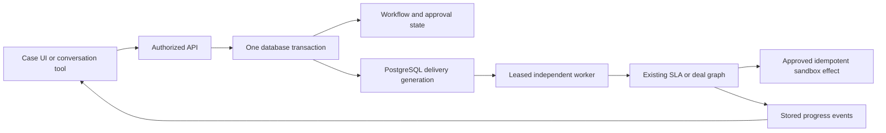

# Unit 8 — Durable delivery and operating evidence

Completed November 16, 2026. Builds on the SLA and deal approval workflows in Units 6–7. [Development plan](DEVELOPMENT_PLAN.md) · [Runbook](OPERATIONS.md) · [Measured results](UNIT_08_RESULTS.md).

## What is delivered

| Function | Implementation and behavior | Knowledge used | Prompt requirements |
|---|---|---|---|
| Atomic intake and durable dispatch | Workflow start, approved decision and owner resume write a queue generation in the same PostgreSQL transaction as business state. HTTP 202 means saved/accepted, not executed. Duplicate request keys keep their existing result. | Transactions, transactional outbox, idempotency, schema migrations | R1 backend/concurrency; R6 complete workflow |
| Separate recoverable workers | `runtime/worker.py` runs embedded for the demo or as independent processes. Expiring token leases, heartbeats, periodic reconciliation and generation-aware acknowledgments preserve work across API/worker death. | At-least-once delivery, leases, fencing, checkpoints, process shutdown | R1 reliability; R2 bounded retry/verification; R5 control |
| Capacity, fairness and recovery limits | Central active-workflow limits, tenant round-robin scheduling and global/per-tenant worker slots. Repeated transport failures become stopped/dead deliveries; owners explicitly recover after fixing the cause. | Backpressure, fair scheduling, bounded retries, concurrency control | R1 concurrency/errors; R5 controlled recovery |
| Distributed model admission | PostgreSQL coordinates per-tenant/global concurrency and sliding-minute request counts across API processes. Calls have deadlines and bounded input/output/run size. | Distributed rate limits, deadlines, resource budgets | R1 backend; R4 observable failures |
| Replayable progress | Authorized SSE endpoints emit stored event IDs; browser fetch uses bearer headers, reconnects with a cursor, and retains polling fallback. Server rechecks access during streaming. | SSE framing, cursors, cancellation, authorization on replay | R1 permissions; R3 saved state; R5 visibility/control |
| Operating dashboard | Operations aggregates outcomes, queue health, timing and saved model usage; recent traces link case/deal, workflow, conversation, originating run, approval and operation IDs. | SQL aggregation, metric denominators, timing state machines, provenance | R4 observability; R6 measured sandbox outcomes |
| Backup and restore | Quiesced custom PostgreSQL archive plus private files, SHA-256 manifest, new-database-only restore and record-count/file checks. Test resumes an approval from restored checkpoints. | Consistent backups, private file permissions, integrity checks, recovery drills | R1 persistence; R5 recoverability |
| Reproducible recovery/load evidence | Real loopback HTTP burst, two independent worker processes, killed workers, committed-effect replay, authenticated browser reconnect and restore checks. | Fault injection, load measurement, isolation, reproducibility | R1 concurrency; R4 evaluation; R6 evidence |

Requirement IDs refer to the original prompt mapped in the plan. Unit 8 contributes to all six; it does not complete dynamic planning, collaborating specialists, governed memory or real business ROI.

## Queue architecture and invariants

Migration `0006_durable_runtime` adds central limits, tenant scheduling, jobs, delivery attempts, worker heartbeats and provider permits. It also adds timing counters to the shared workflow table. The existing LangGraph checkpointer and SLA/deal adapters remain.

The earlier Redis Streams proposal is replaced by a PostgreSQL queue of record. The project already depends on PostgreSQL; committing delivery and workflow state together avoids a database/broker publication gap. This is a deliberate implementation choice, not a claim that PostgreSQL is the best queue at every scale. Locking uses short advisory transaction locks and `FOR UPDATE SKIP LOCKED`; see the [PostgreSQL SELECT documentation](https://www.postgresql.org/docs/current/sql-select.html).

A workflow has one queue row. Enqueuing increments its generation. A new human decision arriving before an older delivery is acknowledged cannot be lost: the old acknowledgment notices the newer generation. Lease tokens prevent an older reclaimed delivery from acknowledging a new lease. A lease alone does not ensure exactly-once business execution: the existing workflow mutex, approval/version checks, transactional operation records and unique receipts protect committed sandbox effects. A paused old process can overlap a replacement after lease expiry; only the authorized business transaction may commit the effect.

Reconciliation runs periodically in workers, in batches of up to 100 repairs/expired leases. It recreates missing/idle deliveries for runnable workflows, reclaims expired leases and retires pending delivery for human waits or terminal states. Dead runnable deliveries require explicit owner recovery. The former startup-only recovery of up to 50 workflows is removed.

The API never starts a graph in its request background tasks. `demo` starts a worker for local convenience; `demo --api-only` plus `worker` demonstrates process independence. Chat replies themselves remain request-bound, with existing durable run outcomes; Unit 8 queues the business workflows started by chat, not every conversational model call.

## Defaults and bounded behavior

| Setting | Default | Meaning |
|---|---:|---|
| Active workflows | 500 global / 100 per tenant | All nonterminal work, including human waits; new starts receive 429 with Retry-After at capacity |
| Leased worker jobs | 4 global / 1 per tenant | Central limit across processes; local worker defaults to two slots |
| Lease | 15 seconds | Heartbeat every lease/3; periodic reclaim after expiry |
| Delivery failure budget | 5 deliveries per generation | Escaped dispatch/storage failures back off up to 30 seconds; repeated failures/expired leases stop delivery |
| Business retry budget | Existing 3 transient failures | Existing graph error categories, five proposal-revision limit and approval expiry still apply |
| Model concurrency | 2 global / 1 per tenant | Distributed permits expire after 120 seconds if the caller dies |
| Model request rate | 60 global / 30 per tenant per rolling minute | Rejection is explicit; no invisible SDK retries |
| Model call deadline | 45 seconds | Existing whole-request/run/tool bounds still apply |
| Model context/output bound | 262,144 serialized input bytes / 4,096 output tokens | Input byte limit is not an exact token estimate or provider TPM quota |

Limits live in `runtime_settings`, so all processes read the same configuration. Active human reviews reserve workflow capacity: accepting their later decision does not depend on capacity being free for a new workflow. Fair scheduling is among tenants with ready work; it cannot preempt a running job or guarantee a latency SLA.

Model admission failures return 429. Interrupted conversational calls remain visible; the system does not automatically replay a model/tool sequence with possible effects. Transport retries are distinct from business retries. Dead delivery does not invent a business completion or discard the saved approval. The workflow UI displays the stopped delivery and owner recovery action.

## Progress and authorization

- `GET /v1/sla-workflows/{id}/events` and the deal equivalent accept `Last-Event-ID` or `?after=<id>`. Tokens belong only in the Authorization header.
- Stored events are ordered by ID, in batches of 100. The stream sends heartbeat comments, closes after 25 seconds for reconnect, and emits `closed` after terminal history is drained.
- Each batch revalidates current actor, tenant and workflow participation. Revocation ends the stream and clears the displayed workflow; reconnect repeats authorization.
- The UI refreshes saved workflow details on progress and polls every ten seconds as fallback. Progress streaming is not token streaming or time-to-first-token measurement.
- Cancellation preserves already committed action receipts. Resume/decision retains exact proposal, version, designated reviewer and current-evidence checks.
- Start/resume chat tools cite an immutable authorized request acknowledgment. An acknowledgment proves acceptance, not approval or execution; current state comes from a fresh workflow read.

## Dashboard and metric definitions

`GET /v1/operations?days=7` accepts 1–30 days. The UI offers 1, 7 or 30. Operations employees see their tenant's aggregate workflow/model measures. Other employees see their requested/assigned workflows and their own conversation model usage. Recent trace details are always requester/reviewer scoped, even for Operations. No bearer token or private memo text is included in the summary.

| Metric | Definition and limitation |
|---|---|
| Outcomes | Current status of workflows created in the reporting window, grouped by SLA/deal and status; includes waiting, cancelled, failed and partial |
| Queue/alerts | Current scoped delivery backlog across all creation dates; stopped deliveries, expired pending reviews, oldest pending age; worker heartbeat is global infrastructure health |
| System elapsed | Lifetime in nonterminal states other than input/review waits, including queue and retry delay; p50/p95 over measured workflows created in the window, including in-progress workflows |
| Human wait | Lifetime in `waiting_for_input` or `waiting_for_approval`; not CPU time or customer SLA compliance |
| Timing coverage | Only workflows created after migration with timing enabled; older histories are excluded rather than guessed |
| Worker active | Sum of finished delivery durations for the workflow cohort; excludes missing durations after abrupt worker death, and is not CPU usage |
| Queue wait p95 | Delivery start minus latest enqueue timestamp for attempts belonging to the cohort; retries can contribute multiple samples |
| Model calls/usage | Saved conversation events in the time window; started, failed and provider-reported usage. Debug/stateless calls and external billing are not reconstructed |
| Inference cost | `null`/unknown; no verified versioned price schedule exists. Missing usage is also explicit, never assumed zero |
| Correlation | Workflow, conversation, origin run when started by chat, approval and committed operation IDs; direct UI workflows may have no originating model run |

These are operational sandbox measures, not customer resolution time, actual SLA compliance or ROI. OpenTelemetry export, live-model evaluation, verified billing/cost, external alert routing and pilot manual baselines remain later work.

## Verification and next step

190 Python tests with real PostgreSQL, 18 browser tests, TypeScript/production build, a 200-request isolated HTTP burst and a real backup/restore drill passed. See [results and reproduction commands](UNIT_08_RESULTS.md). No real CRM, credit provider or customer messaging is involved.

Unit 9 adds bounded task context, private large-output inspection, measured hybrid retrieval/reranking and governed memory while preserving the authorization, source freshness and approval boundaries established here.
